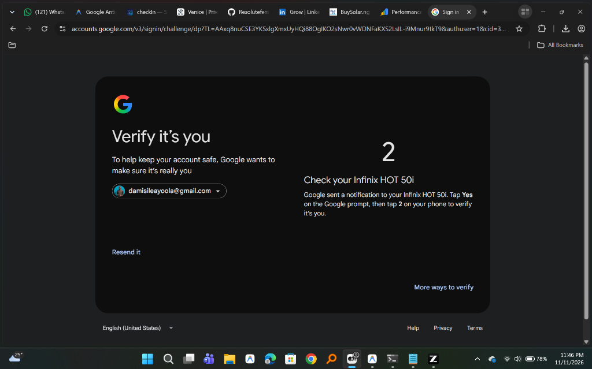

# OmniID 🛡️
> **Universal Hardware-Independent Biometric Emergency Vault & Disaster Recovery Protocol**  
> *Never get locked out of your digital life when your phone dies, gets stolen, or runs out of power.*

[](https://opensource.org/licenses/MIT)
[](https://www.typescriptlang.org/)
[](https://nextjs.org/)
[](https://w3c.github.io/webcrypto/)
[](#)

---

## 1. The Real-World Problem: The "Dead Phone" Paradox

Modern cybersecurity (Passkeys, Google Authenticator, SMS OTP, FIDO2) assumes your primary smartphone is **always alive, charged, and connected**.

In reality—especially across emerging tech hubs (Lagos, Nairobi, Bangalore, São Paulo) and for global remote workers—power outages hit, phone batteries hit 0%, screens shatter, and devices get stolen in transit.

When you walk up to a borrowed laptop or cybercafé PC to deploy code or verify an account, Google or your cloud console halts you:

<p align="center">
  
</p>

> **"Check your Infinix HOT 50i. Google sent a notification to your Infinix HOT 50i. Tap 2 on your phone to verify it's you."**

If your phone is dead, **you are locked out for 12+ hours.** You miss client deployments on AWS, cannot push commits to GitHub, cannot approve crypto transactions, and cannot access email.

### What OmniID Does
OmniID is the **hardware-independent disaster recovery lifeline**. Walk up to any borrowed laptop or incognito browser:
1. Scan your face (via client-side WebAssembly camera capture).
2. Enter your private 4-digit **Twin-Shield PIN**.
3. In under **1.8 seconds**, decrypt an ephemeral, in-memory **TOTP Authenticator Vault** rendered on an HTML5 `<canvas>` for 45 seconds.
4. Input the 6-digit recovery code into Google/GitHub, close the tab, and **RAM is immediately zeroized.**

---

## 2. Threat Mitigation: The "Twin Parity Defense"

### "What about identical twins?"
Identical (monozygotic) twins share the exact same DNA and virtually indistinguishable facial bone geometry. Even Apple Face ID's official security guide concedes that monozygotic twins can cause false positive biometric matches on hardware IR sensors. Standard laptop webcams cannot differentiate identical twins on face vectors alone.

**OmniID solves this by enforcing a 2-of-2 Zero-Knowledge Hybrid Vault:**

$$\text{Vault Key } K = \text{FuzzyRecover}(\text{FaceVector}, W) \oplus \text{Argon2id}(\text{Private PIN})$$

```
+------------------------------------------------------------------------------------+
|                         THE TWIN PARITY DEFENSE WORKFLOW                           |
+------------------------------------------------------------------------------------+
|                                                                                    |
|  [ Identical Twin walks up to camera ]                                             |
|           |                                                                        |
|           v                                                                        |
|  1. Webcam Scans Twin's Face -> Biometric Codeword (C) is recovered (Matches!)     |
|           |                                                                        |
|           v                                                                        |
|  2. System prompts for mental 4-6 digit Salt PIN (or secret gesture sequence)     |
|           |                                                                        |
|           +---> Twin doesn't know the private PIN in your head                     |
|           |                                                                        |
|           v                                                                        |
|  3. Key Derivation Fails: K = C ⊕ Argon2id(Wrong_PIN) = Mathematical Garbage       |
|           |                                                                        |
|           v                                                                        |
|  [ AES-256-GCM Vault refuses to decrypt. Zero biometric or key leakage. ]          |
+------------------------------------------------------------------------------------+
```

- **Factor 1 (Who you are):** Your facial vector replaces carrying physical hardware tokens.
- **Factor 2 (What you know):** Your memorized 4-digit PIN.
- **The Result:** Even if your identical twin stands directly in front of the camera, without your mental factor, the ciphertext cannot decrypt.

---

## 3. Cryptographic & Security Architecture

1. **Zero Raw Biometric Storage:**
   - Raw pictures, JPEGs, and raw embeddings are **never** transmitted to any server.
   - Embeddings are quantized into binary strings and scrambled with a random secret codeword $C$ via a **Fuzzy Commitment Scheme**:
     $$W = \mathbf{b} \oplus C$$
   - Only Helper Data $W$ (which reveals zero information about the face) is stored.
2. **Active Chromatic Anti-Spoofing (Liveness):**
   - The screen flashes a randomized sequence of RGB colors (`#10b981`, `#3b82f6`, `#ec4899`).
   - The client measures the sub-surface specular skin reflection in real time, stopping printed photos, 4K video replays, and deepfake injection.
3. **Isolated Canvas Rendering (Anti-DOM Scraping):**
   - Decrypted TOTP codes are drawn directly to an HTML5 `<canvas>` with randomized sub-pixel jitter.
   - Codes **never exist as text nodes in the HTML DOM**, neutralizing browser extension scrapers and keyloggers.
4. **Duress Decoy Mode:**
   - If forced to unlock under physical coercion, entering a duress PIN or performing a specific facial gesture opens a **Decoy Fake Vault** with benign codes while silently triggering emergency alerts.

---

## 4. 3-Tier Business & Monetization Model

| Tier | Price | Features |
| :--- | :--- | :--- |
| **Tier 1: Lifeline** | **Free Forever** | 3 Critical TOTP Accounts (Google, GitHub, AWS), Active Chromatic Anti-Spoofing, Twin-Shield PIN. |
| **Tier 2: Pro Dev** | **$39 Lifetime Deal** (or $4/mo) | Unlimited accounts & backup codes, Duress Decoy Mode, encrypted SSH/Env secrets, priority recovery. |
| **Tier 3: Recovery SDK** | **$0.04 / active recovery** | Drop-in React SDK (`npm i @omni-id/react`) for crypto exchanges & fintechs to eliminate account-reset support tickets. |

---

## 5. Getting Started & Local Development

### Prerequisites
- Node.js 18+ (tested on Node.js 24 LTS)
- npm or pnpm

### Installation
```bash
# Clone the repository
git clone https://github.com/Ayoola-tech2024/OmniID.git
cd OmniID

# Install dependencies
npm install

# Start local development server
npm run dev
```

Open [http://localhost:3000](http://localhost:3000) in your browser:
- **/enroll**: Set up your Face Vector + 4-digit PIN + Emergency accounts.
- **/recover**: Test disaster recovery (simulating incognito mode or a borrowed laptop).

---

## 6. Project Roadmap

- [x] **Phase 1: Cryptographic Core & Fuzzy Vault**
  - [x] Client-side quantization & Hamming distance verification.
  - [x] WebCrypto AES-256-GCM vault encryption.
  - [x] Twin-Shield 2-factor Argon2id/PBKDF2 PIN derivation.
- [x] **Phase 2: Emergency Lifeline MVP**
  - [x] RFC 6238 in-memory TOTP generator.
  - [x] Anti-scraping HTML5 Canvas viewer with 45s ephemeral auto-zeroize.
  - [x] Active Chromatic Liveness check.
  - [x] Portable Rescue Card (.json) export.
- [ ] **Phase 3: Zero-Knowledge Cloud Sync & Decentralized Storage**
  - [ ] Supabase / Cloudflare Workers D1 edge integration.
  - [ ] Web3 / Decentralized Identity (DID) anchor.
- [ ] **Phase 4: Developer SDK (`@omni-id/react`)**
  - [ ] Drop-in `<OmniIDRecoveryButton />` component for fintech & Web3 apps.

---

## License
MIT © 2026 [Ayoola-tech2024](https://github.com/Ayoola-tech2024). Designed and engineered with ❤️ in Lagos, Nigeria.
